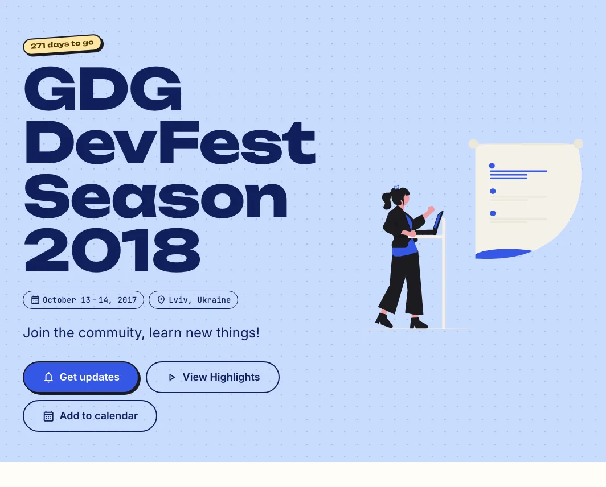
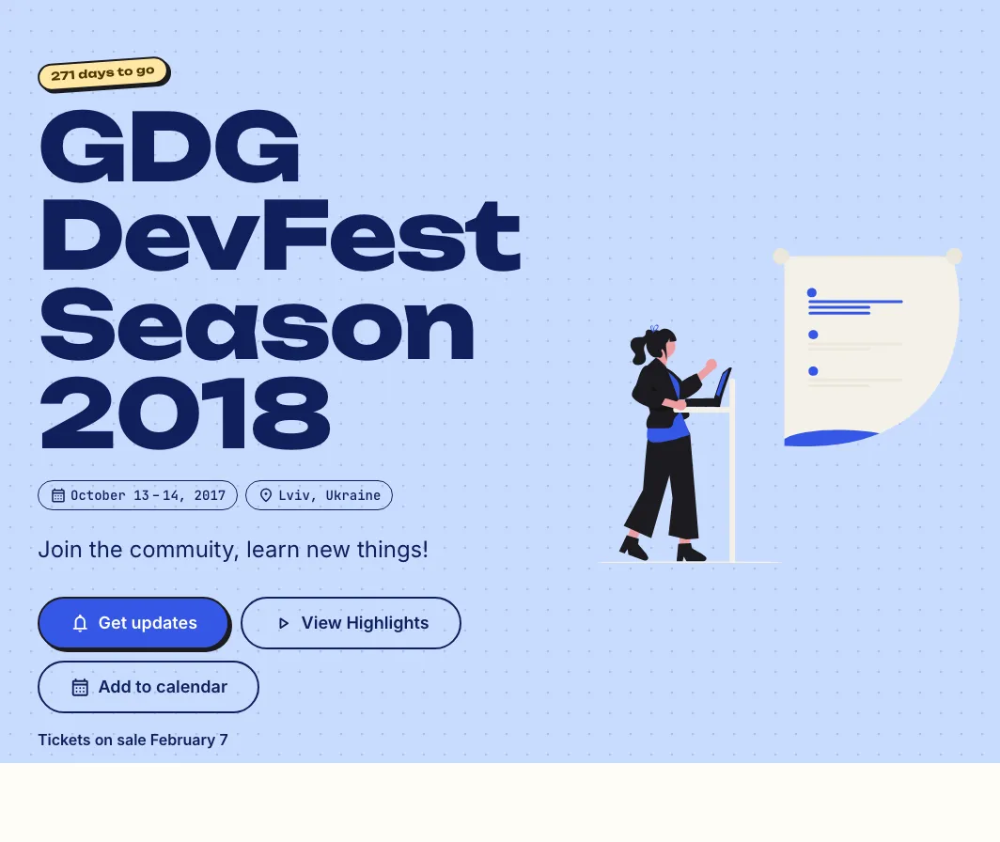
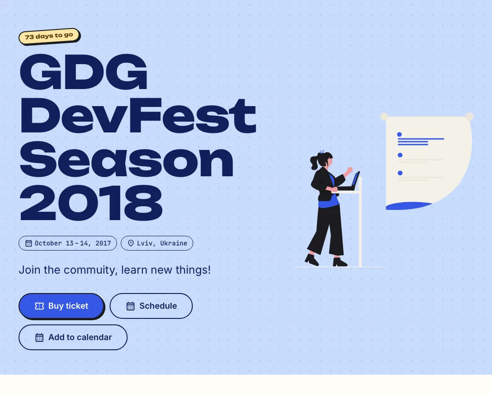
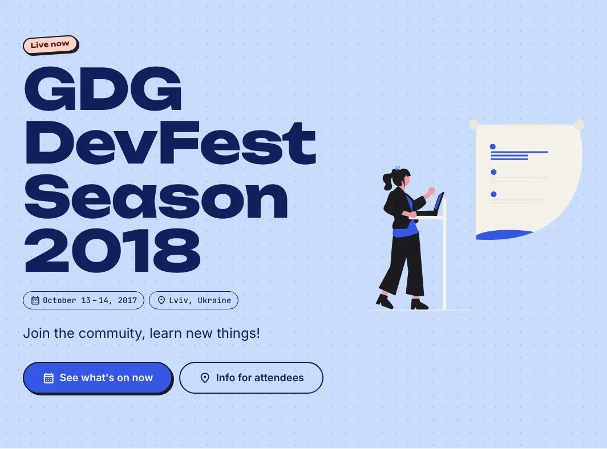

# Run your event

What to publish before, during and after the event, and what visitors see at each stage. See [How it works](../how-it-works.md#what-visitors-see-changes-on-its-own) for how the site determines its stage from your dates and content.

**For:** [first-time organizers](../README.md#first-time-organizer), [returning organizers](../README.md#returning-organizer) and [content editors](../README.md#content-editor).

The screenshots show the demo site's home page at each stage, in the `festival` theme.

## See where you are

`./hb status --production` reads your content and prints the stages the site is in, and what changes next:

```console
Stages: announced, call for papers (closes after 2027-03-01), ticket sales (not yet on sale)
Next: tickets go on sale on 2027-02-07
The schedule shows once sessions have a day and times.
```

To see a stage before it comes, run `npm start`. On the emulators every site has a bar across the top, which says DEV. Its clock picks any date and time at the event, and the page shows what visitors would see then. See [Features reference](../reference/features.md#demo).

To load one stage of Hoverboard's demo event into the emulator, run:

```console
./hb data seed --stage first-call
```

`--stage <fixture>` replaces the emulator's content with part of the sample data for a stage such as `first-announced`, `first-call`, `first-schedule`, `returning-live` or `archived`. It moves the sample sessions onto the demo's event days, empties the content collections the fixture doesn't have, keeps visitor data, and prints the time to pick on the dev bar's clock and any `site.json` changes to try. The fixtures are in `packages/web/__tests__/fixtures/stages.ts`. Run `./hb data seed` again to restore all the sample data.

## Before the event

### Announce



Deploy as soon as you have the name, the dates and the place. The site shows only what has content:

- The hero counts the days to go, and offers **Get updates**, the [subscribe](manage-data.md#export-collections-as-csv) band, and **Add to calendar**. It adds the highlights video, `aboutBlock.callToAction.howItWas` in `content/resources.json`, when you have one.
- The speakers and schedule pages say they're coming soon. The navigation and the home page leave out every feature without content, such as the team, the partners and the blog, until you add it. See [Features reference](../reference/features.md).

A returning event starts here too, with last year's team, partners, photos and videos. See [Next edition](next-edition.md). Until the event, the photos and videos say they're from past editions.

### Open the call for papers


Add `callForPapers` to `site.json`, with its link and its first and last day, and deploy once. See [Content](content.md#speakers-sessions-partners-and-tickets-in-firestore). While it's open, **Submit a talk** is the first button in the header and the hero, and the speakers page links to it. It opens and closes on its days without another deploy.

### Sell tickets



Add the tickets in Firestore, with `salesOpen` and `salesClose`, the first and last day of each ticket's sales. Before the first sale opens, the hero says when tickets go on sale, and each ticket's button says its own day. While a ticket is on sale, **Buy ticket** is the first button. Set `soldOut` when one sells out, and the tickets band says when all have. The tickets band stays during the event, for the days still to come, and goes once it's over.

### Publish the speakers, then the schedule



Add speakers as they confirm. The speakers page and the speakers band show with the first one. Each speaker's and session's page ends with **Speaking here? Report a mistake**, which emails you.

Give each session its day, times and track, then set `schedule.published` to `true` in `site.json` (see [Schedule](schedule.md)). The schedule shows in the navigation and the hero, and visitors can save sessions to My Schedule and add them to their calendar. From then on, the site downloads the schedule for offline use, so attendees can open it at the venue without a connection.

Deploy after each change, so the pages built from your content match it. See [How it works](../how-it-works.md#how-pages-are-built).

## During the event



On the event's days, in `event.timezone`:

- The hero says **Live now**, and offers what's on now. At an in-person or hybrid event, it adds **Info for attendees**, the [attending page](attending-page.md) with the doors, the Wi-Fi and the floor plan, which works offline. At an online or hybrid event, **Watch live** opens `event.stream`.
- The home page shows **On now** below the hero: the sessions that are on, and the ones about to start.
- Each session takes feedback from its start for a week, and reactions until a week after it ends.

On the day:

- **Fix the schedule** in the Firebase console. Visitors see the change the next time a page opens, and a deploy updates the rendered HTML ([Deploy](deploy.md)).
- **Send notifications**, such as "Doors open", with `./hb notify --production`. See [Notifications](notifications.md).
- **Don't upgrade Hoverboard.** From a week before the event to its last day, `./hb upgrade` warns that an upgrade could break the site when attendees need it. See [Upgrade](upgrade.md).

## After the event


The day after the event, the hero thanks attendees, and offers the videos, the photos and **Get updates**. The tickets band goes.

- **Add the videos and the photos** in Firestore, and deploy. Give each photo an `alt` that says what it shows. See [Accessibility](accessibility.md).
- **Send speakers their feedback.** `./hb edition feedback --production` writes each session's ratings and comments to CSV files, without user IDs. See [Next edition](next-edition.md#manage-the-archives).
- **Export your subscribers** for your mailing list, with `./hb data export --csv --collection subscribers --production`. See [Manage data](manage-data.md#export-collections-as-csv).
- **Start the next edition** when you have its dates. The old site becomes an archive with a banner that links to the new one, and the new one starts at [Announce](#announce). See [Next edition](next-edition.md).

## See also

- [Schedule](schedule.md)
- [Notifications](notifications.md)
- [Next edition](next-edition.md)
- [How it works](../how-it-works.md#what-visitors-see-changes-on-its-own)
